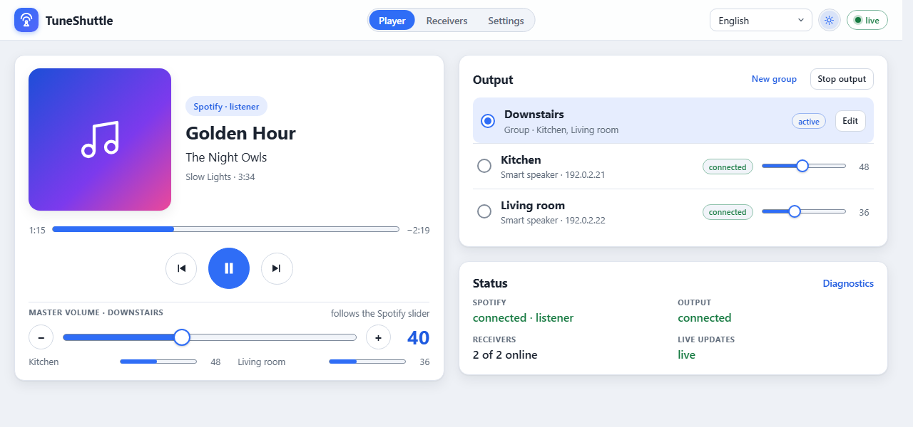
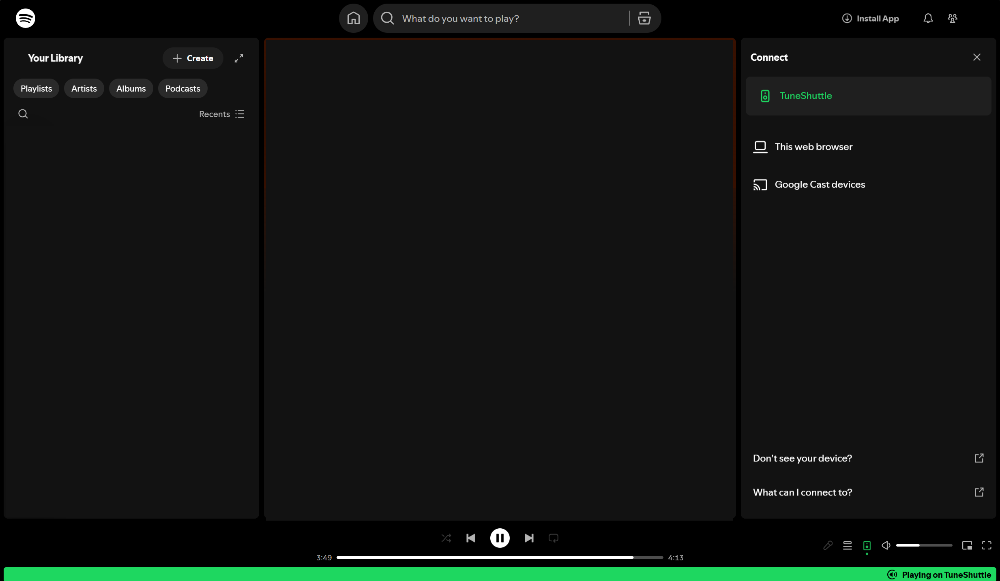
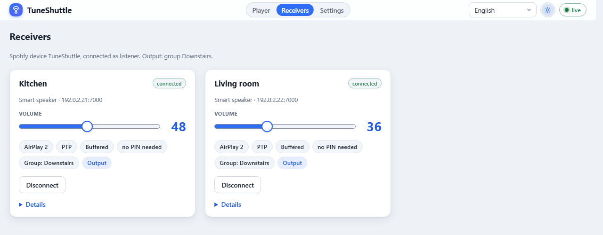
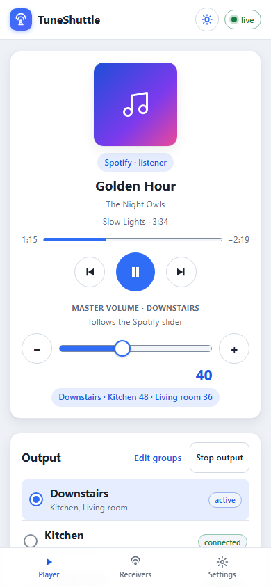
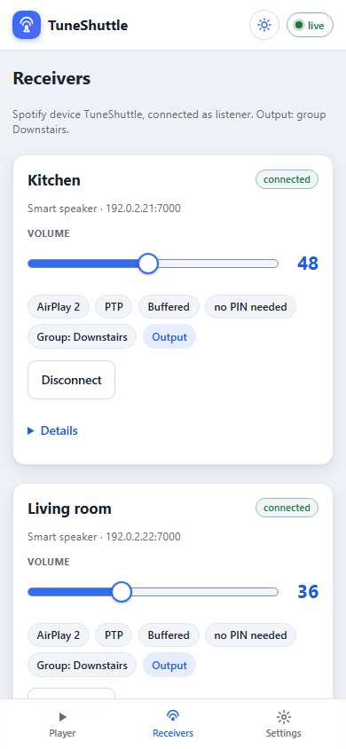
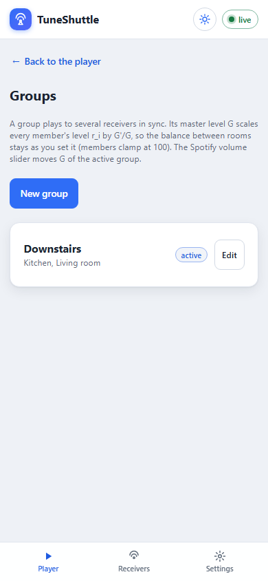

# TuneShuttle

Your speakers, your music, from whatever you have in your hand.

If you own AirPlay 2 speakers, you know the catch: they play happily from an iPhone or a Mac, but the Spotify app
doesn't see them as something it can play to. TuneShuttle closes that gap. It runs quietly on a computer at home and
turns your speakers into Spotify Connect devices, so you pick them in Spotify like any other speaker. It also works
the other way around: your iPhone, iPad or Mac sees "TuneShuttle" in its AirPlay menu and plays to it.

Either way, the sound comes out of the speakers you chose, in one room or in several rooms at once, all in step.

<picture>
  <source media="(prefers-color-scheme: dark)" srcset="docs/images/player-dark.png">
  
</picture>

## What it's like to use

In Spotify, you choose TuneShuttle from the device list and press play. From an Apple device, you choose TuneShuttle in
the AirPlay menu. Whoever started last gets the speakers.



Everything else happens in a small web app in your browser, on your phone or at your desk. It finds the AirPlay
speakers on your network, helps you pair them, and lets you build groups: "Kitchen and living room", "Whole house",
"Just the bedroom". You choose where the music goes, set a volume for each room, and from then on you mostly forget it
is there.

<picture>
  <source media="(prefers-color-scheme: dark)" srcset="docs/images/receivers-dark.png">
  
</picture>

It works just as well on a phone:

<table>
  <tr>
    <td>
      <picture>
        <source media="(prefers-color-scheme: dark)" srcset="docs/images/player-phone-dark.png">
        
      </picture>
    </td>
    <td>
      <picture>
        <source media="(prefers-color-scheme: dark)" srcset="docs/images/receivers-phone-dark.png">
        
      </picture>
    </td>
    <td>
      <picture>
        <source media="(prefers-color-scheme: dark)" srcset="docs/images/groups-phone-dark.png">
        
      </picture>
    </td>
  </tr>
</table>

## Getting it running

TuneShuttle is a small server application that runs on Windows, on Linux, or in a container. To try it from a
checkout you need the .NET 10 SDK:

```powershell
dotnet run --project src/Bridge.Service
```

Then open <http://localhost:8080>. Spotify needs a Premium account. For running it permanently as a service, and for
everything else you may run into along the way, see the [documentation](docs/README.md).

## What's inside

TuneShuttle is built from a few pieces that you can also use by themselves: an AirPlay 2 sender and an AirPlay 2
receiver library, a small command-line tool for talking to speakers, and a C# port of
[librespot](https://github.com/librespot-org/librespot) for the Spotify side. It is written in C#.

## Licence

TuneShuttle is released under the MIT licence ([`LICENSE`](LICENSE)). Parts of it are ports of other projects and keep
the licence of the original: `librespot-dotnet/` is a port of librespot (MIT), and the ALAC audio codec in
`src/Airplay2.Sender/Alac` is a port of Apple's ALAC (Apache-2.0); the ported files keep their original notices.
owntone-server (GPL-2.0) was read to understand how it keeps speakers in sync, but none of its code was copied. FFmpeg
(LGPL) is loaded from your system at run time and is not part of the build. The projects the code was written against
are listed in [`docs/REFERENCE-SOURCES.md`](docs/REFERENCE-SOURCES.md).

TuneShuttle is an independent project and is not affiliated with or endorsed by Spotify or Apple.
